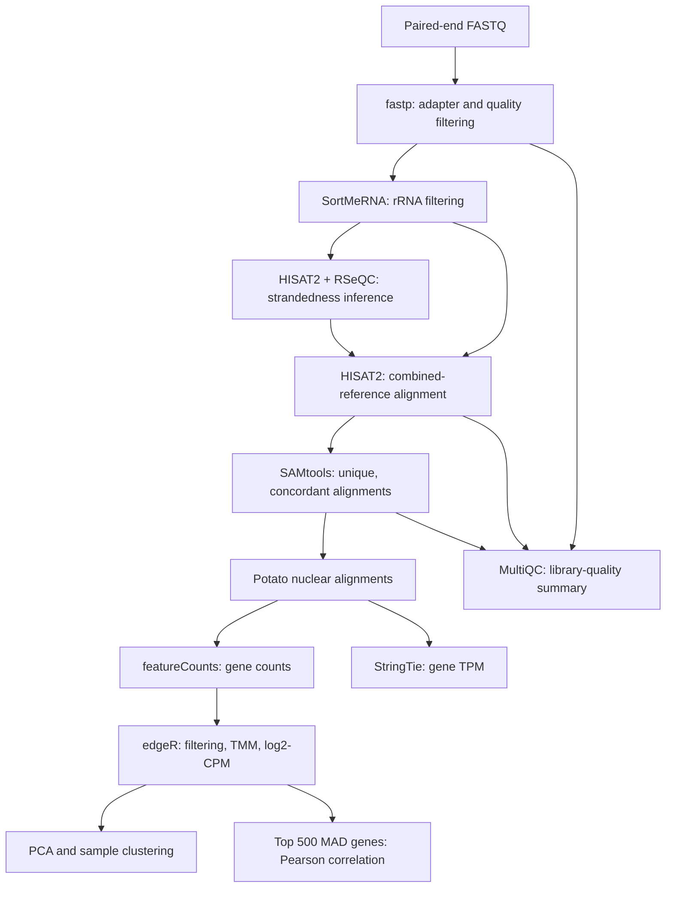

# Potato-*Phytophthora infestans* bulk RNA-seq workflow

This README documents the Snakemake workflow implemented in `workflow/` for processing 27 paired-end RNA-seq libraries generated from potato (*Solanum tuberosum* cv. Atlantic) leaves. The dataset comprises three biological replicates for each of nine sampling conditions: a 0-h water-treated mock baseline and *Phytophthora infestans*-inoculated samples collected at 4, 8, 12, 16, 20, 24, 48 and 72 h post-inoculation (hpi).

The workflow performs read preprocessing, rRNA filtering, strandedness inference, competitive host–pathogen alignment, potato nuclear gene quantification, library-level quality assessment, and sample-relationship analysis.

## Contents

- [Potato-*Phytophthora infestans* bulk RNA-seq workflow](#potato-phytophthora-infestans-bulk-rna-seq-workflow)
  - [Contents](#contents)
  - [Workflow overview](#workflow-overview)
  - [Workflow structure](#workflow-structure)
  - [Workflow inputs](#workflow-inputs)
    - [Sample table](#sample-table)
    - [Configuration](#configuration)
    - [References](#references)
  - [Processing steps](#processing-steps)
  - [Normalization and sample relationships](#normalization-and-sample-relationships)
  - [Run the workflow](#run-the-workflow)
  - [Main workflow outputs](#main-workflow-outputs)
    - [`results/01.pre_analysis/`](#results01pre_analysis)
    - [`results/02.pre_assesment/`](#results02pre_assesment)
    - [`results/03.expression/`](#results03expression)
    - [`results/04.sample_relationship/`](#results04sample_relationship)

## Workflow overview



All 27 libraries were classified as RF (reverse-stranded) in the completed run. The workflow uses the `batch` field to annotate sample-relationship outputs but does not perform batch correction. No differential-expression testing is included.

## Workflow structure

The workflow directory is organized as follows:

```text
workflow/
├── Snakefile
├── config/
│   ├── config.yaml
│   └── sample.tsv
├── rules/
├── scripts/
├── envs/
└── profiles/
    └── local/
```

- `Snakefile` is the workflow entry point.
- `config/sample.tsv` defines the libraries and FASTQ inputs.
- `config/config.yaml` defines references, output locations, resource limits and analysis parameters.
- `rules/` contains the Snakemake rules.
- `scripts/` contains helper and downstream analysis scripts.
- `envs/` contains tool-specific Conda environments.
- `profiles/local/` contains the local Snakemake execution profile.

By default, the main workflow output directory is `results/`, which is located alongside `workflow/`:

```text
project_root/
├── workflow/
└── results/
```

## Workflow inputs

### Sample table

`workflow/config/sample.tsv` contains one library per row with the following required columns:

| Column | Description |
|---|---|
| `sample` | Library identifier |
| `condition` | Experimental condition or sampling time |
| `replicate` | Biological replicate |
| `batch` | Batch annotation used in sample-relationship outputs |
| `r1` | Read 1 FASTQ path |
| `r2` | Read 2 FASTQ path |

Relative FASTQ paths are resolved from the sample-table directory.

### Configuration

`workflow/config/config.yaml` specifies the sample table, output paths, reference files, resource limits and workflow parameters.

**Before running the workflow, edit `workflow/config/sample.tsv` and `workflow/config/config.yaml` to match the actual directory structure on your system.** In particular, check and update:

- paired FASTQ paths;
- potato, organellar and *P. infestans* reference FASTA files;
- the potato genome annotation;
- the SortMeRNA reference database;
- `output_dir`;
- `quantification.stu_bam_dir`; and
- any machine-specific resource settings.

Do not assume that the example paths supplied with the repository will match another system.

### References

Competitive alignment uses a combined reference containing:

- the *Solanum tuberosum* SolTub_3.0 nuclear genome (`GCA_000226075.1`);
- potato mitochondrial sequences (`MN104801.1`, `MN104802.1` and `MN104803.1`);
- the potato chloroplast genome (`NC_008096.2`); and
- the *P. infestans* T30-4 genome ASM14294v1 (`GCA_000142945.1`).

Potato gene quantification uses the Ensembl Plants release 59 SolTub_3.0 annotation (`Solanum_tuberosum.SolTub_3.0.59.gff3`). Potato and pathogen sequence names use the prefixes `Stu_` and `Pinf_`, respectively. `workflow/scripts/combine_genomes.sh` builds the combined FASTA from the configured source FASTAs. rRNA screening uses the SortMeRNA default rRNA database v4.3.

Before constructing the job graph, the Snakefile checks that the sample table, FASTQs and configured reference files exist. It builds the SortMeRNA and HISAT2 indexes and converts the potato GFF3 annotation to a `Stu_`-prefixed GTF when required.

## Processing steps

| Stage | Implemented analysis | Main output |
|---|---|---|
| Read cleaning | `fastp` detects paired-end adapters and performs quality trimming using `--cut_front`, `--cut_tail`, `--cut_right`, `--n_base_limit 0` and `--average_qual 20`, and writes per-library JSON and HTML reports. | Clean paired reads and fastp reports under `results/01.pre_analysis/{sample}/01.cleandata/` |
| rRNA filtering | SortMeRNA screens both mates against the rRNA database using `--paired_in`, `--out2`, `--fastx` and `--other`, and separates rRNA and non-rRNA pairs. | Paired non-rRNA reads, rRNA reads and `rRNA_stats.tsv` under `results/01.pre_analysis/{sample}/02.sortmerna/` |
| Strandedness inference | `seqtk` selects up to 200,000 non-rRNA pairs per library using seed 17. HISAT2 prealigns the subset to the combined reference, and RSeQC `infer_experiment.py` determines library orientation. | Per-library `strandness.tsv` files and merged `results/02.pre_assesment/02.strandness/strandness_summary.tsv` |
| Competitive alignment | HISAT2 aligns non-rRNA pairs to the combined potato–pathogen reference using `-k 5`, `--max-intronlen 20000`, `--no-mixed`, `--no-discordant` and the inferred strand orientation. Alignments are restricted to `NH:i:1` and filtered with SAMtools `-f 3 -F 3852 -q 30` before sorting and indexing. | Filtered BAMs, HISAT2 summaries, SAMtools flagstats and host–pathogen mapping composition |
| Potato quantification | SAMtools extracts `Stu_` nuclear contigs while excluding `Stu_mt_` and `Stu_cp`. featureCounts quantifies paired fragments over exons by `gene_id` using `-p --countReadPairs -B -C -t exon -g gene_id` with reverse-stranded assignment. StringTie estimates reference-guided gene TPM using `-G`, `-e`, `-A` and `--rf`. | `results/03.expression/matrices/gene_readcount.tsv` and `gene_tpm.tsv` |
| Sample relationships | edgeR retains genes with total raw counts >10, applies TMM normalization and calculates log2-CPM. PCA, Pearson correlations and hierarchical clustering are calculated from the transformed matrix. | Tables and PDFs under `results/04.sample_relationship/edgeR/` |
| QC summary | MultiQC summarizes fastp, HISAT2 and SAMtools reports. SortMeRNA statistics remain in their per-library output files. | `results/02.pre_assesment/01.multiQC/multiQC.html` |

## Normalization and sample relationships

The merged raw-count matrix contains 40,336 potato genes across 27 libraries. `workflow/scripts/sample_relationship.R` retains genes whose raw counts sum to **more than 10** across all libraries, leaving 24,858 genes.

For the edgeR branch, the script:

1. creates an edgeR `DGEList`;
2. calculates TMM normalization factors;
3. generates log2-CPM values using `cpm(log = TRUE, prior.count = 2)`;
4. performs PCA and Euclidean-distance sample clustering using all retained genes; and
5. calculates Pearson correlations using the 500 genes with the highest positive median absolute deviation (MAD), followed by average-linkage hierarchical clustering.

TPM values are generated independently by StringTie and are not used as input for these analyses.

The sample-relationship analyses reported in the manuscript use the edgeR branch. To reproduce these outputs, set `sample_relationship.method` to `"edgeR"` in `workflow/config/config.yaml`.

## Run the workflow

Snakemake and Conda are required.

Before execution, update `workflow/config/sample.tsv` and `workflow/config/config.yaml` to match the actual FASTQ, reference, output and nuclear-BAM locations on the system being used. The supplied paths should be treated as examples rather than portable defaults.

The supplied local profile requests 18 CPU cores and 60 GiB of memory. Adjust these settings if necessary for the available system.

From the project root, first inspect the planned jobs:

```bash
snakemake --snakefile workflow/Snakefile \
  --profile workflow/profiles/local \
  --dry-run
```

Then run the workflow:

```bash
snakemake --snakefile workflow/Snakefile \
  --profile workflow/profiles/local
```

The profile enables the tool-specific Conda environments in `workflow/envs/`.

Cleaned FASTQs, non-rRNA FASTQs and combined-reference BAMs are marked as temporary intermediate files. Use Snakemake's `--notemp` option if these files should be retained.

## Main workflow outputs

The main workflow outputs are written under `results/` in processing order:

```text
results/
├── 01.pre_analysis/
│   └── {sample}/
│       ├── 01.cleandata/
│       └── 02.sortmerna/
├── 02.pre_assesment/
│   ├── 01.multiQC/
│   │   └── multiQC.html
│   └── 02.strandness/
│       └── strandness_summary.tsv
├── 03.expression/
│   └── matrices/
│       ├── gene_readcount.tsv
│       └── gene_tpm.tsv
└── 04.sample_relationship/
    └── edgeR/
        └── transformed_expression.tsv
```

### `results/01.pre_analysis/`

Contains per-library preprocessing outputs.

- `{sample}/01.cleandata/`: cleaned paired FASTQs and fastp JSON/HTML reports.
- `{sample}/02.sortmerna/`: paired non-rRNA reads, rRNA reads and `rRNA_stats.tsv`.

Temporary FASTQ files may be removed automatically by Snakemake unless the workflow is run with `--notemp`.

### `results/02.pre_assesment/`

Contains workflow-level quality assessment and library-orientation summaries.

- `01.multiQC/multiQC.html`: combined fastp, HISAT2 and SAMtools quality summary.
- `02.strandness/strandness_summary.tsv`: merged strandedness assessment across libraries.

Additional mapping-composition and per-library alignment statistics are produced by the corresponding workflow rules.

### `results/03.expression/`

Contains the merged potato gene-expression matrices.

- `matrices/gene_readcount.tsv`: unnormalized featureCounts fragment counts for 40,336 genes × 27 libraries.
- `matrices/gene_tpm.tsv`: StringTie gene TPM values for the same 40,336 genes × 27 libraries.

Potato nuclear BAMs are written to the location specified by `quantification.stu_bam_dir` in `workflow/config/config.yaml`. This path should be changed to an appropriate local directory before running the workflow.

### `results/04.sample_relationship/`

Contains normalized expression matrices and sample-relationship analyses.

- `edgeR/transformed_expression.tsv`: TMM-normalized log2-CPM values for 24,858 retained genes × 27 libraries;
- PCA scores and PCA plots;
- the sample-correlation matrix and heatmap; and
- hierarchical sample-clustering output.
